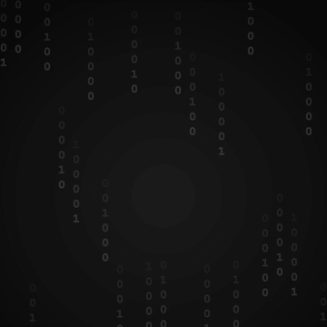
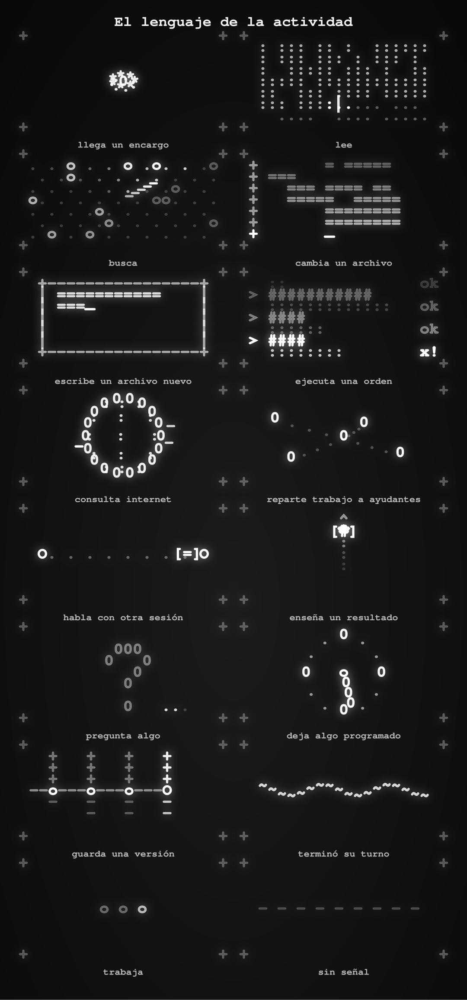

# Sendell en directo

The drawing engine behind Sendell's ASCII avatar: a figure made of zeros that talks, gestures, changes shape and
draws what an AI agent is doing (reading, editing, running a command, delegating, asking) with one animated pattern
per kind of activity. White on near-black, pure functions of time, no dependencies.

By [Sendell](https://sendell.co). Code comments and design notes are in Spanish; this README is in English.



## What is in this repository

| Path | What it does |
|---|---|
| `nucleo/` | The engine. `avatar(estado, t)` returns a list of cells `{x, y, c, …}`: poses, gaze, mouth driven by voice volume, mood, materialisation and morphing into ~125 shapes (animals, machines, 3D solids, tools, nature, symbols). `patron(tipo, t)` draws the activity language. Same code in Node and the browser; output to SVG or canvas. No `Math.random`, no clocks: any frame can be recomputed on its own |
| `hojas/` | Contact sheets of the avatar, the shapes and the activity language (SVG, and PNG with `rsvg-convert`) |
| `video/` | Short clips: SVG frames → `rsvg-convert` → `ffmpeg` |
| `agente/` | **"Crea tu agente"** ("Build your agent"): a bilingual (ES/EN) page where a business describes the agent it needs while Sendell takes the shape and colour they pick. Prototype: it **sends nothing**, it shows the resulting brief on screen |
| `guardian/` | A privacy guard: flags or masks secrets, tokens, e-mails, IPs and absolute paths before anything becomes public, robust to zero-width characters, look-alike letters and escaped JSON. Tested with planted fake secrets ("canaries") |
| `captura/esquema.mjs` | The contract of a work event (types, fields, validation) that the drawings consume |



## Run it

Requirements: Node 22+. For sheets and video, `rsvg-convert` (librsvg) and `ffmpeg`.

```bash
npm test                    # 147 tests: engine, privacy guard, "Crea tu agente" flow (1 skipped: it compares the figure with the private website copy, set SENDELL_SITIO to run it)
npm run agente              # "Crea tu agente" at http://127.0.0.1:8770/agente/
npm run hoja                # avatar sheets in hojas/
npm run video:avatar        # salida/demo-avatar.mp4 (about 50 s on a 4-core CPU)
npm run video:formas        # salida/demo-formas.mp4
node hojas/hoja-lenguaje.mjs   # the activity-language sheet
```

## Status (honest)

Works, and was run from this clean copy: 146 of 147 tests pass and 1 is skipped (it needs the private website copy), the avatar video renders (330 frames), the sheets
render, and the "Crea tu agente" page is served locally.

Not included, on purpose:
- **The live capture.** The original project follows real agent sessions (Claude Code transcripts, an OpenClaw
  audit log, git commits) to feed the drawings. Those readers, the session/alias tables and their tests are left
  out because they read private data. Only the event contract (`captura/esquema.mjs`) is here. `DISENO.md` keeps
  the design of the whole system as a record.
- **The local-network habitat page** that showed the live sessions at home. It depends on the capture.
- **No voice and no narrated videos yet.** `voz` (mouth opening) is an input; nothing here produces audio.
- `guardian/huellas.mjs` can check text against a private fingerprint index if you create one
  (`SENDELL_DIR_PRIVADO`); without it, that check is simply skipped.

## License

Proposed: Apache License 2.0 ([LICENSE](LICENSE)). No third-party code or assets; no npm dependencies.
The Sendell name and avatar are the Sendell brand.
